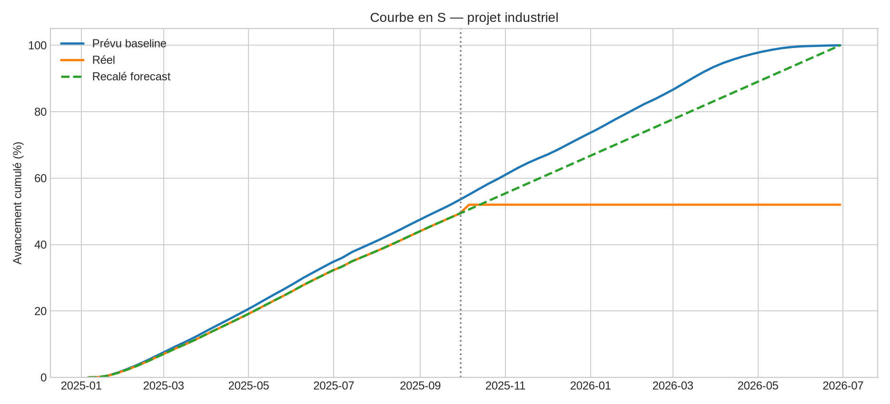
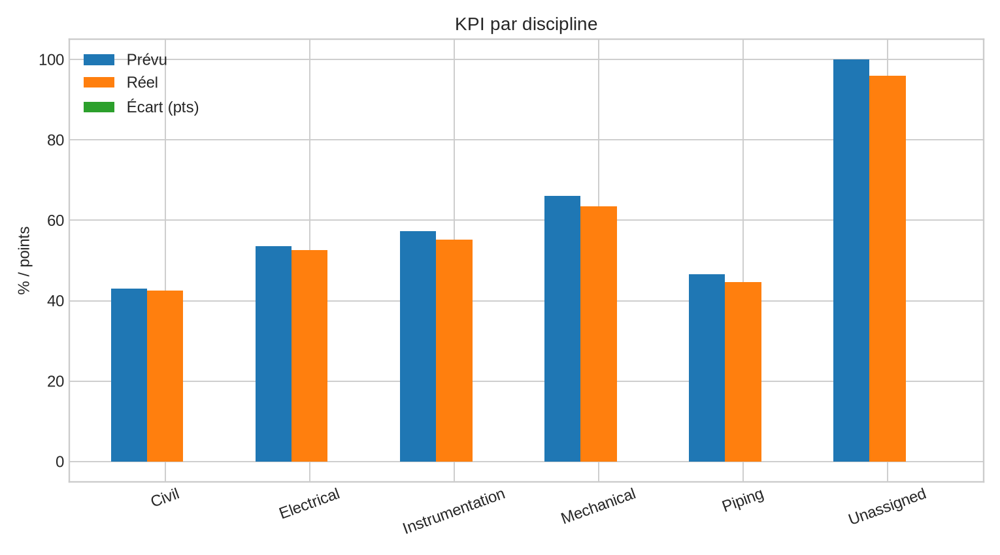
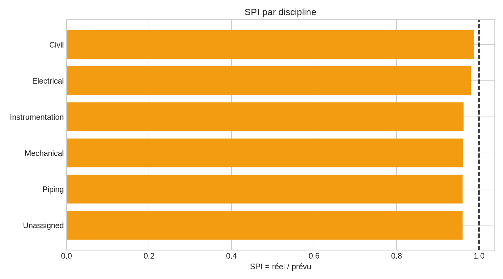

# Project Progress Reporting — Courbes en S / Power BI

## Contexte

Ce projet reproduit un reporting mensuel d'avancement pour un projet industriel. Les données sont **simulées au format d'un export Primavera P6** : elles ne proviennent pas d'un projet réel. Le périmètre comporte 300 activités réparties sur 5 disciplines métier, 3 zones et 4 Data Dates successives.

## Dashboard

[Ouvrir le dashboard statique](index.html)

Le reporting présente la baseline prévue, l'avancement réel, le recalé forecast, l'écart en points, le SPI, les activités en retard et les KPI par discipline.

## Résultats du dernier snapshot

Au Data Date du **30 septembre 2025**, l'avancement prévu pondéré est de **53,4 %** et l'avancement réel de **49,3 %**, soit un écart de **−4,1 points**. Le SPI est de **0,922**, ce qui place le projet dans la zone orange de vigilance. Les données brutes contiennent 300 activités ; après dédoublonnage et correction documentée, 299 activités alimentent les agrégats propres.

Cinq anomalies volontaires sont détectées dans le dernier export : avancement supérieur à 100 %, activité terminée sans date de fin, date de fin baseline antérieure au début, discipline manquante et doublon d'Activity ID. Elles sont conservées dans l'onglet Contrôles pour démontrer le fonctionnement du contrôle qualité.

## Méthode

Pour chaque activité, l'avancement prévu est réparti linéairement entre `BL Start` et `BL Finish`, puis agrégé avec une pondération égale aux `Budgeted Labor Units`. L'avancement réel est le `Physical % Complete` pondéré au Data Date. Le recalé conserve le réel au dernier Data Date puis répartit le reste à faire jusqu'à la fin du projet. Le détail est documenté dans [methode_courbe_S.md](docs/methode_courbe_S.md).

## Structure du dépôt

`data/raw/` contient quatre exports mensuels simulés. `data/processed/` contient les activités propres, la série hebdomadaire de courbe en S et les KPI par discipline. `excel/project_progress_reporting.xlsx` contient les onglets Import, Contrôles, Données propres, KPI discipline et Courbe S. `powerbi/` contient les mesures DAX, la requête Power Query et les vues SQL prêtes à reproduire dans Power BI. `docs/` contient le standard, la procédure mensuelle et la méthode.

## Standard et actualisation

La procédure consiste à exporter depuis P6, déposer le CSV nommé `p6_export_YYYYMMDD.csv`, actualiser la transformation, contrôler les anomalies puis publier le rapport. Le modèle est réutilisable en remplaçant les exports dans `data/raw/`. La [procédure détaillée](docs/procedure_mise_a_jour.md) et le [standard de reporting](docs/standard_reporting.md) précisent les champs, KPI et seuils.

## Limite Power BI

Le dépôt fournit les mesures DAX, le script Power Query et la structure de pages. Un binaire `.pbit` nécessite Power BI Desktop ou le service Power BI, indisponible dans cet environnement Linux ; aucun faux fichier `.pbit` n'est publié. Le [guide Power BI](powerbi/README.md) explique la reproduction du modèle.
